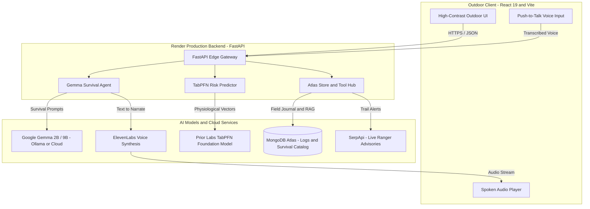

<div align="center">

  

  # WildCraft AI

  **Edge-Ready Wilderness Survival Whisperer & Backcountry Physiological Risk Engine**

  An intelligent backcountry survival and physiological risk assistant designed with a dual-mode architecture: fully feature-complete when cloud-connected, yet capable of running standalone in disconnected, zero-signal wilderness environments through local on-device fallbacks.

  <p align="center">
    <a href="https://wildcraft.swayamk.tech"><strong>Explore Live Demo »</strong></a>
    <br />
    <br />
    <a href="#dual-mode-architecture--offline-resilience">Dual-Mode Architecture</a>
    ·
    <a href="#architecture">Architecture</a>
    ·
    <a href="#repository-structure">Repository Structure</a>
    ·
    <a href="#environment-variables">Configuration</a>
    ·
    <a href="#local-development-setup">Quickstart</a>
    ·
    <a href="#api-reference">API Reference</a>
  </p>

  <p align="center">
    <a href="https://wildcraft.swayamk.tech">
      
    </a>
    
    
    
  </p>

  <p align="center">
    
    
    
    
    
    
    
    
    
  </p>

</div>

---

## 📖 Overview

**WildCraft AI** is an intelligent backcountry survival and physiological risk assistant. It is designed with a **dual-mode architecture**: fully feature-complete when cloud-connected, yet capable of running standalone in disconnected, zero-signal wilderness environments through local on-device fallbacks.

### 📶 Dual-Mode Architecture & Offline Resilience

| Feature | ☁️ Connected Mode (Full Cloud) | 📵 Offline / Edge Mode | Offline Trade-offs & Requirements |
| :--- | :--- | :--- | :--- |
| **Survival LLM** | Google Gemma 2 (9B) Cloud API | Local Ollama (`gemma3:1b` / `gemma:2b`) | Requires local Ollama daemon; smaller model parameter size |
| **Risk Prediction** | Prior Labs TabPFN Foundation Model | Calibrated physiological physics engine | Mathematical heuristic formulas instead of full tabular transformer weights |
| **Plant & Field RAG** | MongoDB Atlas Cloud Database | Bundled local JSON catalog | Queries static local manual (~8–50 entries); no remote catalog expansion |
| **Voice Narration** | ElevenLabs HD Audio Stream | Browser Web SpeechSynthesis API | Robotic browser-synthesized voice rather than neural audio streaming |
| **Field Journal** | MongoDB Atlas cloud persistence | Browser memory & local JSON export | Entries stored locally until manually exported or reconnected |
| **Weather & Alerts** | Live Open-Meteo & SerpApi searches | Cached emergency advisories & manual input | Cannot retrieve live storm alerts or active wildfire broadcast updates |

---

## 🏗️ Architecture



---

## 📂 Repository Structure

```text
wildcraft/
├── api/
│   └── index.py                     # Vercel serverless function entrypoint
├── backend/
│   ├── app.py                       # FastAPI application & API route definitions
│   ├── gemma_survival_agent.py      # Gemma LLM harness (Ollama + Google Cloud Gemma 2)
│   ├── tabpfn_survival.py           # TabPFN physiological risk predictor & physics model
│   ├── atlas_survival_store.py      # MongoDB Atlas client, auto-seeder & RAG query engine
│   ├── elevenlabs_voice.py          # ElevenLabs text-to-speech streaming integration
│   ├── serpapi_alerts.py            # Live trail closure and ranger advisory search
│   ├── weather_elevation.py         # Open-Meteo elevation and GPS weather integration
│   ├── seed_atlas.py                # Standalone database seeding & verification CLI
│   ├── requirements.txt             # Python backend dependencies
│   ├── .env.example                 # Environment variable template
│   └── data/                        # Static datasets & knowledge catalogs
│       ├── survival_manual_catalog.json
│       └── wilderness_survival_tabular.csv
├── frontend/
│   ├── src/
│   │   ├── components/
│   │   │   ├── GemmaBushcraftWhisperer.jsx  # Hands-free AI guide & audio player
│   │   │   ├── TabPFNRiskPredictor.jsx      # Telemetry input & risk score visualizer
│   │   │   ├── PlantSafetyScanner.jsx       # Field manual & plant safety lookup
│   │   │   ├── BackcountryLogbook.jsx       # Atlas-backed field journal
│   │   │   └── HomePage.jsx                 # Overview dashboard & GPS weather status
│   │   ├── App.jsx                          # Main shell & tab navigation
│   │   └── index.css                        # Design system & outdoor high-contrast themes
│   ├── package.json                         # Frontend dependencies
│   └── vite.config.js                       # Vite build configuration with /api proxy
├── vercel.json                              # Production deployment & route rewrite config
└── README.md
```

---

## ⚙️ Environment Variables

Create a `.env` file inside `backend/` based on `backend/.env.example`:

| Variable | Description | Required? |
| :--- | :--- | :--- |
| `GEMINI_API_KEY` | Google AI Studio API Key for Gemma 2 Cloud inference | Recommended |
| `MONGODB_URI` | MongoDB Atlas connection string (`mongodb+srv://...`) | Recommended |
| `TABPFN_API_KEY` | Prior Labs API Key for TabPFN Foundation Model weights | Optional (falls back to calibrated physics) |
| `ELEVENLABS_API_KEY`| ElevenLabs API Key for voice narration | Optional (falls back to browser TTS) |
| `SERPAPI_KEY` | SerpApi Key for real-time Google ranger advisories | Optional (falls back to cached advisory) |
| `OLLAMA_URL` | Local or remote Ollama server URL (default: `http://localhost:11434`) | Optional (local dev) |
| `OLLAMA_MODEL` | Ollama model tag (default: `gemma3:1b`) | Optional |

---

## 🚀 Local Development Setup

### Prerequisites

- Python 3.10+
- Node.js 18+ & npm
- *(Optional)* [Ollama](https://ollama.com) installed with `ollama pull gemma3:1b`

### 1. Backend Setup

```bash
cd backend

# Create and activate virtual environment
python3 -m venv venv
source venv/bin/activate        # On Windows: venv\Scripts\activate

# Install dependencies
pip install -r requirements.txt

# Configure environment
cp .env.example .env
# Edit .env with your credentials

# Verify MongoDB Atlas connection & seed database
python seed_atlas.py

# Launch FastAPI development server
python -m uvicorn app:app --host 0.0.0.0 --port 8001 --reload
```

The API will be available at `http://localhost:8001` (Interactive Swagger docs: `http://localhost:8001/docs`).

### 2. Frontend Setup

In a new terminal window:

```bash
cd frontend

# Install dependencies
npm install

# Start Vite development server
npm run dev
```

Open `http://localhost:5173` in your browser.

---

## 📡 API Reference

### Survival & AI Agent
- **`POST /api/survival-guide`**: Queries the Gemma model agent with RAG context grounding.
  ```json
  {
    "user_prompt": "Is a banana covered in black spots safe to eat?",
    "offline_mode": false
  }
  ```
- **`POST /api/synthesize-voice`**: Converts survival guide text into speech via ElevenLabs.

### Physiological Modeling
- **`POST /api/predict-survival-risk`**: Computes hypothermia, heat stroke, and dehydration risk from trek telemetry using Prior Labs TabPFN.
  ```json
  {
    "elevation_m": 1850.0,
    "ambient_temp_c": 5.0,
    "relative_humidity_pct": 75.0,
    "wind_speed_kmh": 25.0,
    "trek_duration_hours": 4.0,
    "water_consumed_liters": 1.0,
    "clothing_insulation_clo": 1.2
  }
  ```

### Data & Catalog
- **`GET /api/survival-catalog`**: Searches MongoDB Atlas survival and plant database by keyword/category.
- **`GET /api/backcountry-logs`**: Fetches saved trek entries from MongoDB Atlas.
- **`POST /api/backcountry-log`**: Persists a new field log to MongoDB Atlas.

### Environmental Telemetry
- **`GET /api/wilderness-weather?lat=44.42&lon=-110.58`**: Retrieves elevation and current meteorological conditions via Open-Meteo.
- **`GET /api/trail-alerts?location=Sierra+Trail`**: Fetches active ranger alerts and weather warnings via SerpApi.

---

## 🚢 Production Deployment (Vercel)

The repository includes a ready-to-deploy [`vercel.json`](./vercel.json) configuration that builds the Vite frontend and deploys the FastAPI backend as Python serverless functions.

1. Push your repository to GitHub:
   ```bash
   git add .
   git commit -m "Deploy WildCraft AI"
   git push origin main
   ```
2. Import the repository into **[Vercel](https://vercel.com/new)**.
3. If deployed from a monorepo, set **Root Directory** to `wildcraft` (or leave default `./`).
4. Add your environment variables in the Vercel dashboard:
   - `GEMINI_API_KEY`
   - `MONGODB_URI`
   - `TABPFN_API_KEY`
   - `ELEVENLABS_API_KEY`
   - `SERPAPI_KEY`
5. Click **Deploy**.

---

## 📄 License

This project is open-source and licensed under the [MIT License](LICENSE).
